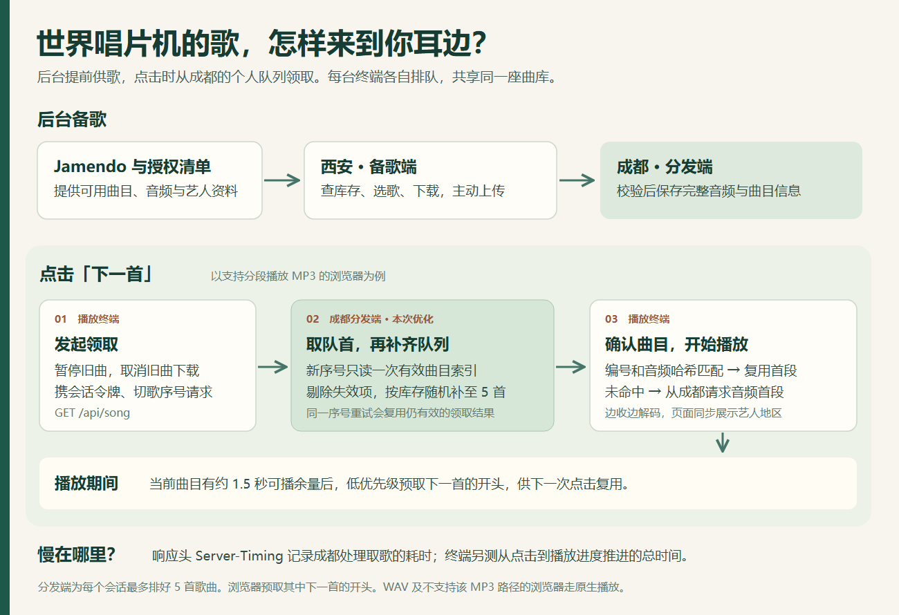

# 🌍 世界唱片机 · World Vinyl

点击唱片，随机听一首世界各地的音乐。像素地球随歌曲点亮艺人的来源地或活动地区，唱片上同步显示封面、作者和许可信息。浏览器连接分发端即可收听；使用 Jamendo 时，由备歌端访问音源。

- 播放完整歌曲，显示作者、歌曲原页和 Creative Commons 许可证。
- 启动后准备第一首歌，点击播放才出声；歌曲结束后自动连播。
- 分发端为每个会话准备最多 5 首待播歌曲。浏览器在当前歌曲播放时，预取下一首 MP3 的开头。
- 歌曲信息、音频和地区查询独立进行；未知地区不会阻止播放。

## 当前版本与下载

原型机外观与软件独立编号，当前原型机外观版本为 **1.0**。

**世界唱片机 2.1（v2.1.0）** 包含播放预缓冲和分发端取歌优化。下载发布页顶部「取歌优化版源码」后，可分别运行备歌端和分发端，网页播放器由分发端提供。[下载 2.1 源码](https://github.com/Fa-Stars/vinyl-globe/releases/tag/v2.1.0)

### 2.1 各端如何运行

| 运行端 | 职责 | 启动或接入方式 |
|---|---|---|
| 西安备歌端 | 从授权清单随机选歌，核对 Jamendo 下载开关，下载音频、获取艺人地区和许可，主动上传到分发端 | [备歌 Compose](deploy/compose.preparer.yaml) 或 `npm run prepare-tracks` |
| 分发端（本机或国内云服务器） | 校验上传内容，持久化完整歌曲，为每个会话维护随机队列，提供网页和音频分段读取 | [分发 Compose](deploy/compose.distributor.yaml) 或 `npm run distribute` |
| 浏览器播放端 | 显示歌曲与像素地球，播放、暂停和切歌 | 打开分发端网址。本机默认地址为 `http://127.0.0.1:3100/` |
| 实体唱片机 | 可接入同一套会话、取歌和音频接口 | 本版提供对接接口。硬件控制程序和设备本地缓存留待硬件定型后实现 |

### 2.1 如何减少起播后的卡顿



每台终端独立排队。收到新切歌序号时，分发端从 SQLite 覆盖索引读取一次有效曲目编号，用同一份结果清理失效项、领取队首并补队。重复请求最近的序号会返回仍有效的同一首歌。成功响应的 `Server-Timing: song;dur=…` 以毫秒记录取歌处理耗时，浏览器另测点击到播放进度推进的总时间。

成都同场复测使用 10 个独立浏览器会话，每台切 5 首。同步切歌的 P95 从 446 降至 234 毫秒，每台播 1 秒后独立切歌的 P95 从 288 降至 221 毫秒。优化后共 100 次切歌成功，累计观察约 8.6 设备分钟，未记录到超过半秒的播放停顿。当天旧版也未复现早期测试中约 12 秒的长等待。

分发端在返回当前歌曲时，一并提供待播队首的曲目编号和音频哈希。对于支持 MediaSource 播放 MP3 的浏览器，终端按 HTTP Range 每次最多取 256 KiB，累计收到 32 KiB 即可送入解码器，最后一批可更小。当前歌曲有约 1.5 秒可播余量后，终端低优先级预取下一首的开头。手动切歌会取消上一首尚未传完的数据，优先向服务器确认新曲目；编号和哈希匹配时，直接接着使用已预取的数据。WAV 和不支持该 MP3 解码路径的浏览器使用原生音频播放。

**取歌索引优化前的成都内测。** 西安备歌端向成都分发端供歌，西安校园网的 10 个独立浏览器会话经加密连接访问成都。每轮同时开机，每台切 5 首。从点击到新曲目播放进度开始推进计时，播放中进度停滞至少 0.5 秒记为一次卡顿。

| 操作方式 | 两轮切歌中位数 | 两轮播放中卡顿 |
|---|---:|---:|
| 10 台每轮同时切歌 | 0.42 秒 / 0.75 秒 | 1 次（0.85 秒）/ 0 次 |
| 每台播 1 秒后独立切下一首 | 3.56 秒 / 3.52 秒 | 0 次 / 0 次 |

另一次同步测试将最后一首的观察延长到 75 秒。合计 250 次切歌全部成功，约 40.8 设备分钟内记录到两次卡顿（0.85 秒、0.55 秒）。独立快切最慢一次为 11.95 秒，其中 11.76 秒用于等待选歌接口返回。以上数据来自同一校园网出口的浏览器模拟，实体设备和不同运营商仍需分别验收。

### 后端配置

两个后端使用 Node.js 24，运行时只用内置模块。

| 位置 | 启动命令 | 环境变量 |
|---|---|---|
| 国内云或本机模拟分发节点 | `npm run distribute` | `VINYL_LIBRARY_DIR` 为专用持久化目录，`VINYL_UPLOAD_TOKEN` 为两端共享的随机密钥（至少 24 字符），默认地址为 `127.0.0.1:3100` |
| 西安或本机模拟备歌节点 | `npm run prepare-tracks` | `VINYL_DISTRIBUTOR_URL`、`VINYL_UPLOAD_TOKEN`、`VINYL_MANIFEST`（清单绝对路径）。仅使用 Jamendo 来源时需要 `JAMENDO_CLIENT_ID` |

本机联调可使用回环 HTTP。跨机器部署时，对外入口使用 HTTPS。两个独立的 Compose 文件位于 [备歌部署](deploy/compose.preparer.yaml) 和 [分发部署](deploy/compose.distributor.yaml)。在对应机器设置表中变量，用 `docker compose -f deploy/compose.distributor.yaml up -d --build` 或 `docker compose -f deploy/compose.preparer.yaml up -d --build` 启动。备歌容器通过 `VINYL_CATALOG_DIR` 挂载含 `tracks.json` 和授权媒体的目录；分发容器使用自己的命名卷。上传密钥仅供两个后端使用。

**本机试跑（Linux / macOS）。** 在项目根目录用 Node.js 24 运行以下命令，确保 3100 端口空闲。示例在临时目录生成 12 首两秒的 WAV 测试音，用来检查备歌、上传、会话和播放链路。测试 MP3 分段解码时请换用有权分发的 MP3 曲目。

```bash
trial_dir="$(mktemp -d)"
export VINYL_MANIFEST="$trial_dir/catalog/tracks.json"
export VINYL_LIBRARY_DIR="$trial_dir/library"
export VINYL_DISTRIBUTOR_URL=http://127.0.0.1:3100
export VINYL_UPLOAD_TOKEN="$(node -p 'require("node:crypto").randomBytes(32).toString("hex")')"
node test-support/split-fixture.cjs "$trial_dir/catalog"
node services/distributor.js &
distributor_pid=$!
curl --retry 8 --retry-connrefused -fsS "$VINYL_DISTRIBUTOR_URL/api/info"
node services/preparer.js --once
node services/preparer.js --once
```

打开 [本机分发端](http://127.0.0.1:3100/) 试听；结束后在同一终端执行 `kill "$distributor_pid"`。每次单轮备歌最多上传 6 首。常驻运行时，备歌端默认每 30 秒检查库存，上传失败会退避。分发端的 `/api/info` 返回软件版本、模式与可播放曲目数。

**授权清单**由一个备歌服务负责维护。下面是一条自有作品条目的格式示例，清单文件本身是数组。媒体文件使用相对清单目录的路径。曲目标识对应不可变的媒体内容，更换音频或封面时请使用新的标识。

```json
[
  {
    "id": "studio-001", "provider": "local", "file": "studio-001.wav",
    "audioType": "audio/wav", "title": "工作室录音", "artist": "录音作者",
    "countrycode": "CN", "duration": 120,
    "grant": "自有录音或实际授权记录编号", "validUntil": "2027-12-31T23:59:59Z"
  }
]
```

支持 MP3、WAV，以及可选的 `cover` 和 `coverType`（JPEG、PNG、WebP）。Jamendo 条目使用 `provider: "jamendo"`、数字字符串歌曲 ID、实际授权记录 `grant` 以及截止时间 `validUntil`。仅列入已经取得相应云端存储与分发许可的曲目；备歌端还会核对 Jamendo 的逐曲下载开关，并使用其下载地址。备歌端在这些曲目中随机选取，向 Jamendo 获取音频、艺人地区、歌曲原页及逐曲许可；资料无法确认时显示未知地区。仅持有 API 凭证不等于获得设备离线播放或云分发授权。[Jamendo API 使用条款](https://devportal.jamendo.com/api_terms_of_use)

**库存和恢复。** 分发端在 SQLite 事务中校验并发布媒体，重复上传校验一致时复用同一份文件。曲库在重启后保留。默认库存目标为 72 首（`VINYL_TARGET`），媒体总量上限 5 GiB（`VINYL_MAX_BYTES`），单首 16 MiB、单张封面 1 MiB；SQLite 索引、事务日志需要额外磁盘空间。达到目标后停止补货，有新候选时可替换入库超过一天且无人使用的曲目。清单删除的曲目在下次成功同步时撤下；授权到期后，云端自行停止提供该曲。测试和正式环境应使用不同的目录、上传密钥和清单。

**播放接口。** `POST /api/listening-session` 返回临时令牌，以 `X-Vinyl-Session` 传递。每 20 秒心跳，空闲 2 分钟回收。每个播放端独立保留最多 5 首待播；库存充足时，`GET /api/queue` 可预览完整顺序，无需消耗队列。每次开始下一首，调用 `GET /api/song` 并带递增的 `X-Vinyl-Sequence`；重试最近序号会得到同一首。返回的音频地址支持 GET、HEAD 和 HTTP Range。云端重启后客户端重新建立会话。这里的待播数量表示云端可领取的歌曲，设备下载、解码与离线存储策略留给实体端实现。

### 独立桌面版与 iOS 客户端

Windows Electron 桌面版使用内置的单体服务，可下载的 Windows x64 安装包为 **v1.0.2**。iOS 侧载客户端是独立的网页外壳。2.1 以服务端和浏览器播放器源码形式发布。[iOS 侧载说明](ios/README.md)

| 下载 | 用途 |
| --- | --- |
| [Setup 安装版](https://github.com/Fa-Stars/vinyl-globe/releases/download/v1.0.2/World-Vinyl-1.0.2-x64-Setup.exe) | 安装到电脑，可选择安装目录并创建快捷方式 |
| [Portable 免安装版](https://github.com/Fa-Stars/vinyl-globe/releases/download/v1.0.2/World-Vinyl-1.0.2-x64-Portable.exe) | 直接运行，无需安装 Node.js |
| [SHA256 校验文件](https://github.com/Fa-Stars/vinyl-globe/releases/download/v1.0.2/SHA256SUMS.txt) | 核对两个 exe 的下载完整性 |

Windows v1.0.2 包括 Jamendo 完整歌曲与逐曲许可展示、提前缓冲 2 首，以及连续切歌、缓存释放、桌面端口、设置请求竞态和唱片点击响应的修复。首次使用需配置自己的 Jamendo `client_id`，安装包不附带个人凭证或抓取的音频。

安装包构建自 [9924838](https://github.com/Fa-Stars/vinyl-globe/commit/992483815d837d11fc0f43df71c5cc55a7e57452)。原 `v1.0.2` 标签保持不变；标签之后的文档与打包清单整理已纳入该构建。完整发布信息见 [v1.0.2 Release](https://github.com/Fa-Stars/vinyl-globe/releases/tag/v1.0.2)。

当前源码另有尚未打入上述安装包的优化：地图与首都资料不阻塞首歌准备，模式查询和地区查询设有超时，切歌会取消旧地区请求；音频转发只对读取停滞计时，避免正常长传输被固定时限截断；同时修复特殊艺人名称的缓存冲突及桌面设置并发保存问题。体验这些改动需从当前源码运行或重新构建。

当前源码界面采用暖白、胡桃木与墨绿配色，保留唱片和像素地球。歌曲旁展示听歌文案与播放声波，暂停后声波静止；来源和许可链接位于底部。手机端播放控制保持在屏幕底部，支持减少动态效果偏好。地球按像素块投影，减少逐帧计算；设置保存期间等待服务重启，失败可重试，成功刷新界面。

## 单体版快速开始

### Web 版

需要 Node.js ≥ 18。服务端仅使用 Node.js 内置模块，运行 Web 版无需安装 npm 依赖。

1. 在 [Jamendo 开发者后台](https://devportal.jamendo.com) 创建应用，取得自己的 `client_id`。
2. 将 [data/config.example.json](data/config.example.json) 复制为 `data/config.json`，填写凭证：

   ```json
   { "jamendoClientId": "你的 client_id" }
   ```

3. 在项目根目录启动服务：

   ```bash
   node web/server.js
   ```

4. 打开 [本地播放器](http://localhost:3000)。Windows 也可以双击 [web/start.bat](web/start.bat)。

默认监听 `127.0.0.1:3000`。缺少凭证时显示配置提示，不会改用其他曲源。

填写凭证不代表音源已连通。无法选歌时，页面会区分 Jamendo 网络连接失败、音源服务错误和暂未发现可播歌曲；先检查网络、DNS 和代理。确定性请求错误不在同一轮反复重试，自动重试停止后仍保留原因，恢复连接后可点击播放或随机下一首重试。

当前源码为 Jamendo 请求提供备用连接：普通连接出现 DNS 或连接错误时，使用加密 DNS 查询地址，并将 TLS 初始握手拆成连续记录后连接原来的 Jamendo HTTPS 服务。域名与 SNI 保持标准写法，不添加末尾点；完整证书校验保持开启。解析查询只发送主机名，凭证仍直接发送给 Jamendo。备用方式覆盖歌曲、音频与艺人地区查询，不修改系统 DNS、hosts 或 VPN 设置，也不保证在所有网络下均可用。HTTP 错误、证书错误或用户取消不会触发备用。地址仅按 DNS 有效期短暂缓存在内存中，可通过下列环境变量关闭。

| 环境变量 | 用途 |
| --- | --- |
| `JAMENDO_CLIENT_ID` | 替代配置文件中的凭证，优先于文件配置 |
| `PORT` / `WORLD_VINYL_PORT` | 修改端口；`PORT` 优先 |
| `WORLD_VINYL_HOST` | 修改监听地址，默认仅允许本机访问 |
| `WORLD_VINYL_DATA_DIR` | 指定可写数据目录，默认使用项目的 `data/` |
| `WORLD_VINYL_JAMENDO_NETWORK_FALLBACK` | 设为 `0` 关闭 Jamendo 备用连接；默认开启，解析服务为 Cloudflare / Google DoH |
| `WORLD_VINYL_SERVER_MODE` | 设为 `1` 启用常驻服务：闲置 4 首待播、轮换更新、封面代理及有界资料缓存；默认关闭 |

例如修改端口：

```bash
# macOS / Linux
PORT=3001 node web/server.js
```

```powershell
# Windows PowerShell
$env:PORT = 3001
node web/server.js
```

按 `Ctrl+C` 停止服务。默认的 Web 页面会话管理也会在最后一个已连接页面关闭后退出并清理缓存；首次打开页面之前服务会持续等待。

### 单体服务器模式与现有公网入口

2026-11-09 已部署到西安 Ubuntu 服务器，正式公网入口为 **[世界唱片机](https://vinyl.npueis.com/)**。域名 A 记录指向公网网关 `192.248.181.235`，由 Caddy 自动管理 HTTPS 证书，HTTP 自动跳转 HTTPS。访问路径是浏览器 → 法兰克福 Caddy → 独立 SSH 隧道 → 西安 Docker 容器；访客无需安装 Tailscale。原 HTTP IP 入口保留为备用。

`WORLD_VINYL_SERVER_MODE=1` 开启常驻模式；Dockerfile 默认启用。此模式不加访问密码，不依赖 Tailscale，浏览器关闭也不会停止服务。

- 无人访问时准备 **4 首完整音频**，同时准备封面并查询地区；地区暂不可确认时显示未知，封面失败使用本地唱片套。音频准备成功后才计入待播数量。
- 每个播放页面使用独立匿名会话，拥有当前歌曲和 **2 首个人待播歌曲**；领取后立即补充，不消耗其他用户的队列。公共储备可被多人复用，不同用户可以听到相同歌曲，同一音频只下载、保存一份。网页不额外领取服务端待播歌曲。
- 同时最多 **2 个后台下载任务**，优先处理等待播放的请求，再轮流补充各用户的第一、第二首待播，最后补充公共储备。当前最多保留 **10 个页面会话**；满额返回可重试提示，不承诺任意并发量或持续快速跳歌时始终无缓冲。
- 未消费候选 15 分钟过期，从第 10 分钟开始每分钟检查、逐首替换。替代曲准备完成前保留未过期的旧曲；失败会退避，不能保证断网或持续音源故障时始终有 4 首。
- 音频及临时文件合计最多 48 个、总预算 **1 GiB**，单首 16 MiB；调度前为并发下载预留空间，响应未声明长度也受限制。这是磁盘缓存预算，容器内存上限仍为 512 MiB。封面缓存位于内存，最多 64 条、16 MiB，单张 1 MiB；地区记录过期删除并限制 2000 条。Docker 日志轮转为每份 10 MB、最多 3 份。
- 页面每 20 秒心跳，异常断开超过 2 分钟后回收会话，后台仍在播放的页面继续补充。暂停或未开始播放超过 5 分钟，释放个人待播队列、停止补充，恢复时重新准备；正常关闭页面立即释放会话。缓存仅在没有队列、当前歌曲或打开的音频读取占用时删除，某位用户播放结束不会删除别人使用的文件。
- 服务端音频写入完成后即可领取，封面与地区在后台补齐。需要跨重启保存的文件应放在运行缓存目录（audio、songs、jamendo）之外。
- 为维持新鲜待播池，闲置时仍有周期性下载流量；缓存填满不等于以后完全不联网。首次启动或重启需重新准备，不能保证冷启动即播；浏览器首次发声通常仍需要点击播放。
- `/api/info` 返回 `serverMode`、`personalQueues` 与 `buffer`，可查看公共就绪量、会话数量、并发下载及磁盘预算；携带本人 `X-Vinyl-Session` 请求头时另返回自己的 `buffer.personal`。公共 4 首与每人 2 首分别计数；“就绪”要求完整音频下载成功，地区无法确认时仍显示未知。

部署时单独准备一个 UID 1000 可读写的数据目录，将自己的 `config.json` 放在其中，并设置 `WORLD_VINYL_SERVER_DATA` 指向它。凭证和缓存均不进入镜像。确认部署后可在项目根目录使用：

```bash
docker compose up -d --build
```

`compose.yaml` 默认仅发布到宿主机 `127.0.0.1:3000`，运行上限为 1 CPU / 512 MiB 内存，不启动 Electron，也不安装 npm 开发依赖。健康检查仅确认进程/API 存活，音源及待播准备情况另查 `/api/info`。

正式域名与备用 IP 站点均使用网关本机 `127.0.0.1:18084` 的专用隧道，不替换网盘或 OpenFOAM 的域名站点。容器已配置异常退出后重启，独立用户服务 `world-vinyl-relay.service` 负责隧道自动重连；本次没有修改现有 Tailscale、校园网或路由器配置。[deploy/Caddyfile.example](deploy/Caddyfile.example) 提供其他环境的域名 HTTPS 配置模板。

实际部署的代码快照位于服务器的 `$HOME/services/world-vinyl/current`，数据目录为 `/srv/storage/world-vinyl/data`。部署清单保存在 `$HOME/services/world-vinyl/deployment.json`，记录源码归档摘要和镜像版本，不记录凭证。查看状态：

```bash
cd "$HOME/services/world-vinyl"
docker compose -p world-vinyl --env-file .env -f current/compose.yaml ps
systemctl --user status world-vinyl-relay.service
curl http://127.0.0.1:3000/api/info
```

停止或回滚时仅操作该 Compose 项目及其专用隧道，并在网关撤回本服务的域名与 IP 站点；原网关配置已单独备份。Dockerfile 显式将运行文件归属设为 `node`，避免 Windows 归档保留的受限权限阻止非 root 容器启动。

### Desktop 版

开发运行前安装锁定的依赖：

```bash
npm ci
npm start
```

Windows 也可以双击 [desktop/start.bat](desktop/start.bat)。程序自动选择空闲端口，启动内置后端并打开 Electron 窗口。

首次运行请在窗口顶部的「Jamendo 设置」填写凭证，保存后程序会重启内置服务。桌面版把配置和缓存放在 Electron 用户数据目录下的 `data/`，**不读取 Web 版的配置文件，也不继承外部 `JAMENDO_CLIENT_ID`**。

构建 Windows 应用需要 Node.js 22.12 或更高版本。推荐使用 Node.js 24。

```bash
npm run pack   # 生成目录版，Windows 下通常为 desktop/release/win-unpacked/
npm run dist   # 生成 Windows x64 的 NSIS 安装版和 Portable 免安装版
```

产物位于 `desktop/release/`，打包后的程序自带运行环境，无需用户另装 Node.js。目录版必须保留整个输出目录，不能只复制其中的 exe。

安装版和免安装版可在 [GitHub Releases](https://github.com/Fa-Stars/vinyl-globe/releases) 下载；每次发布会注明版本和构建来源。`main` 可能包含发布后的更新，需要尚未发布的功能时可从当前源码构建。

### iOS 版（自用侧载）

`ios/` 是一个 SwiftUI + WKWebView 外壳：全屏显示同一套播放器界面，连接电脑上由
`ios/start-server.bat` 启动的局域网服务（因此需要电脑开着、手机同一 Wi-Fi）。构建走
GitHub Actions 的 macOS 机器产出**未签名** `.ipa`，再用 Sideloadly 配免费 Apple ID
自签安装，不需要 99 美元开发者账号。签名有效期 7 天，到期重签即可。

构建、侧载与限制说明见 [ios/README.md](ios/README.md)。

## 操作

| 操作 | 效果 |
| --- | --- |
| 点击播放按钮或唱片 | 播放 / 暂停 |
| 唱片获得键盘焦点后按 `Enter` 或 `Space` | 播放 / 暂停 |
| 点击 `⏭` | 随机下一首 |
| `Space` | 播放 / 暂停 |
| `R` | 随机下一首 |
| 访问 `/?demo=1` | 尝试自动播放；仍受浏览器自动播放策略限制 |

快捷键会避开输入框、按钮和设置对话框。若 `R` 没有响应，先点击页面空白处。长时间播放不推进时会尝试换歌，连续失败 8 次后停止自动重试；可点击播放主动重试。手动暂停后不会自行恢复。

## 单体版的随机选歌、地区与缓存

- 在 Jamendo 在线曲库的歌曲编号范围内随机抽取，跳过空缺编号、无音频和许可信息不完整的曲目。最多保留 6 首候选，最近 1000 首避免重复；不按热度或地区选歌，也不保证各国家等概率。
- 普通 Web / 桌面模式音频预取目标为 **2 首**，同时只下载 **1 首**。完整缓存最多 3 首，单首上限 16 MiB，总预算 48 MiB（含临时文件），有效期 15 分钟；超出单首上限仍可在线流式播放。服务器模式采用上文的公共 4 首、每会话 2 首及 1 GiB 磁盘预算，过大或无效的音频不会计入待播。
- 切走或播放结束后释放该首音频；歌曲池与远程 URL 仅在当前进程内存中。启动时清理遗留音频和旧歌单，正常退出还会清理地区等运行缓存；强制结束进程可能留有临时文件，下次启动会清理。
- 个人配置与 `catalog-bounds.json` 会保留。后者只含数字编号边界和查询时间，不含歌单或音频。编号边界缓存 6 小时后后台更新，超过 30 天需重新初始化；首次运行可能因边界查询而等待更久。
- 地区表示艺人的来源地或公开声明的活动地区，不等同于国籍，也不按语言或姓名推断。查询顺序为核实资料、Jamendo 艺人资料、MusicBrainz；无法确认时显示「未知地区」。
- 地区证据及身份范围保存在 [verified-artist-countries.json](web/verified-artist-countries.json) 和 [jamendo-country-seed.json](web/jamendo-country-seed.json)，运行清理不会删除它们。

歌曲、封面和地区查询依赖国际互联网，缓存不提供离线曲库功能。歌曲元数据返回不代表已经出声，启动速度还受音源与网络影响。

## 音乐使用范围

本项目仅作为个人非商业联网听歌和原型测试使用，不提供商业曲库授权，也不证明每首歌的全部权利已经核实。使用须遵守 [Jamendo API 条款](https://devportal.jamendo.com/api_terms_of_use) 和每首歌自己的 [Creative Commons 许可证](https://creativecommons.org/faq/)。

- 播放器保留作者、歌曲原页和具体许可链接；目前只接受可识别的 CC BY 系列标准非地区版许可。识别许可格式不等于确认权利归属。
- 保留歌曲要求的署名。NC、ND 等条件需按具体用途判断，不能把原样播放的使用范围直接延伸到改编、分发或商业宣传。
- 临时缓冲仅为播放服务，不提供下载或离线访问。缓存数量和时长是本项目的工程限制，不是平台授予的许可配额。
- 分享仓库、安装包或设备镜像时，不附带抓取的歌曲、封面或个人凭证；协作者使用自己的 `client_id`。
- 公开演示视频、直播、展览或销售实体设备前，另行确认平台及作品、录音、封面的适用授权。演示音轨可使用自制或明确覆盖该用途的素材。

## 开发与验证

后端为原生 Node.js，前端为 HTML/CSS/JavaScript 与 Canvas，桌面外壳使用 Electron。

| 修改内容 | 主要文件 |
| --- | --- |
| 页面与唱片外观 | `web/public/index.html`、`web/public/style.css` |
| 播放交互、地球渲染 | `web/public/app.js` |
| 2.1 分发端、会话队列与曲库 | `services/distributor.js`、`services/cloud-sessions.js`、`services/library.js` |
| 备歌与同步 | `services/preparer.js`、`deploy/compose.preparer.yaml` |
| API、音频转发与缓存 | `web/server.js`、`runtime-cache.js` |
| 随机发现与许可信息解析 | `web/random-discovery.js`、`web/jamendo-metadata.js` |
| Jamendo HTTPS 连接与备用解析 | `web/jamendo-fetch.js`、`web/jamendo-tls.js` |
| 服务器封面代理与缓存 | `web/artwork-cache.js` |
| 多人独立队列、下载调度与共享缓存占用 | `web/listening-sessions.js` |
| 容器部署与公网入口模板 | `Dockerfile`、`compose.yaml`、`deploy/Caddyfile.example` |
| 艺人地区解析 | `web/jamendo-country.js`、`web/country-resolver.js` |
| 桌面启动与设置 | `desktop/electron/main.js`、`desktop/electron/preload.js` |
| 地图与首都坐标 | `web/public/map.json`、`web/public/capitals.json` |

```bash
npm test                                      # 回归测试，使用临时目录与模拟曲源
node web/scripts/build-map.js                  # 重新生成地图数据
node web/scripts/render-globe.js               # 渲染地球预览至 data/globe-*.png
node web/scripts/measure-startup.cjs            # 用真实凭证和隔离缓存测量冷启动
node web/scripts/measure-startup.cjs --reuse-bounds  # 仅复用已有数字编号边界
```

修改地球渲染逻辑时，同步检查预览脚本。测试覆盖播放恢复、快速切歌、音频 Range、缓存限制、授权信息和桌面启动；模拟长时间播放不替代真实网络、系统音频输出和实体硬件验收。

### 验证记录

2.1 发布前使用 Node.js 24 运行完整回归。覆盖 10 个独立会话连续切歌、迟到响应、预取命中、哈希变化、原生播放回退，以及首段分批解码和切歌取消下载。真实网络表现见上文「成都内测」。

早期单体版已验证桌面点击与声音输出、公网 HTTPS 播放、个人队列和像素地球涟漪。历史部署和测试明细可在 [2.0 版 README](https://github.com/Fa-Stars/vinyl-globe/blob/v2.0.0/README.md) 查阅。

`web/scripts/research-countries.cjs` 用于维护地区资料；`data/research-catalog.json` 是该脚本的元数据样本。

### 单体版 Web API

| 端点 | 说明 |
| --- | --- |
| `GET /api/song` | 随机歌曲；服务器个人队列需携带 `X-Vinyl-Session` 和递增的 `X-Vinyl-Sequence`，重复序号返回同一结果；旧客户端可复用公共储备。缺凭证返回 503 / `JAMENDO_SETUP_REQUIRED`；不支持 `country` 筛选 |
| `POST /api/listening-session` | 服务器匿名会话：空请求创建会话；JSON 中携带 `token`、`playing` 发送心跳，`state: disconnect` 释放。会话超时 401、频繁请求 429、满额或待播准备中 503 |
| `GET /api/country?id=...` | 查询艺人地区与来源信息 |
| `GET /api/info` | 当前模式和缓存统计 |
| `GET /api/countries` | 兼容旧客户端，返回空列表 |
| `GET /audio/{id}` | 本地缓存或在线音频流，支持 Range |
| `POST /api/audio/played?id=...` | 普通模式释放音频；服务器模式携带会话头只释放本人占用，不直接删除共享文件 |
| `POST /api/client-session` | 普通 Web 页面会话心跳，用于退出与清理；服务器模式不因此退出 |

仓库不包含个人凭证、抓取音频、运行缓存、`node_modules/` 或打包产物。提交前检查 `.gitignore`；打包文件清单由 `package.json` 管理，排除个人配置和音频文件。
